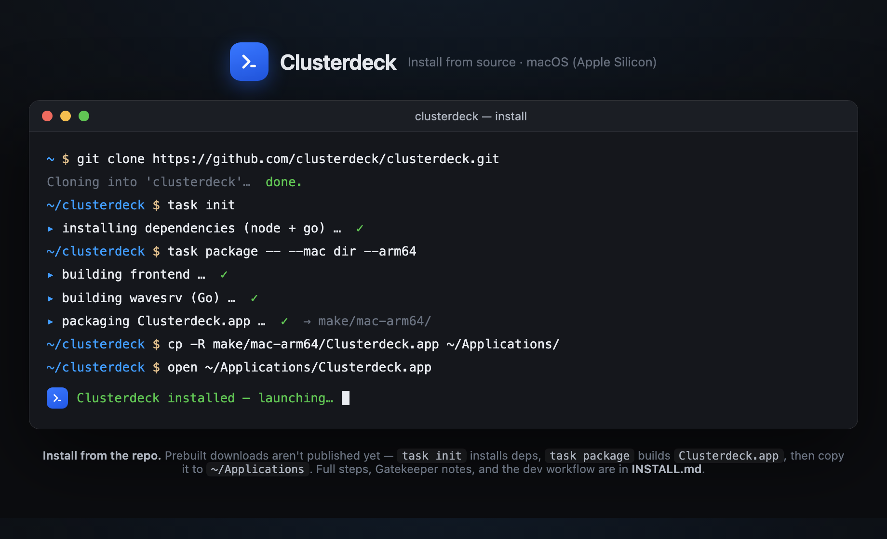

# Installing Clusterdeck

Clusterdeck is **macOS-first** (Apple Silicon `arm64`). The easiest path is Homebrew;
building from source is there too if you want to hack on it.



> The build-from-source flow at a glance (animated version:
> [`clusterdeck-install-demo.html`](docs/clusterdeck/clusterdeck-install-demo.html)).

---

## Option A — Homebrew (recommended)

```sh
brew tap clusterdeck/tap
brew install --appdir=~/Applications --cask clusterdeck
```

`--appdir=~/Applications` installs with **no admin/sudo required** — the app runs fine
from your user Applications folder. Drop that flag to install into `/Applications`
system-wide instead (needs an admin password).

The build isn't code-signed/notarized yet, so Gatekeeper blocks the first launch. Fix:

```sh
xattr -dr com.apple.quarantine ~/Applications/Clusterdeck.app
```

(or right-click the app in Finder → **Open** → **Open**). This caveat is also printed
after `brew install`.

Upgrade later with `brew upgrade --cask clusterdeck`; uninstall with
`brew uninstall --cask clusterdeck`.

---

## Option B — Build & install from source

Produces `Clusterdeck.app` yourself, which you run like any other macOS app.

**Requirements:** macOS 11+, **Node.js** ≥ 22 + npm, **Go** ≥ 1.23,
**[Task](https://taskfile.dev)** (`go-task`), **Git** —
`brew install node go go-task/tap/go-task git`.

```sh
# 1. clone
git clone https://github.com/clusterdeck/app.git clusterdeck
cd clusterdeck

# 2. install dependencies (JS + Go)
task init

# 3. build the app bundle (Apple Silicon)
task package -- --mac dir --arm64
#    -> output: make/mac-arm64/Clusterdeck.app
#    (plain `task package` instead builds unsigned .dmg + .zip for arm64 AND x64)

# 4. install to ~/Applications (no admin needed)
cp -R make/mac-arm64/Clusterdeck.app ~/Applications/

# 5. the local build is unsigned, so clear the quarantine flag once, then launch
xattr -dr com.apple.quarantine ~/Applications/Clusterdeck.app
open ~/Applications/Clusterdeck.app
```

The packaged app stores its data in `~/Library/Application Support/clusterdeck` and
reads config from `~/.config/clusterdeck`. (Running via `task dev` instead uses
`clusterdeck-dev` — kept separate so dev and installed data never collide.)

---

## Option C — Run from source (for development)

Runs the app straight from the repo with hot-reload — no install step.

```sh
git clone https://github.com/clusterdeck/app.git clusterdeck
cd clusterdeck
task init
task dev          # launches the app; frontend changes hot-reload (⌘R)
```

For backend (Go / Electron main) changes, rebuild the server and relaunch:

```sh
task build:server:quickdev
task dev
```

---

## Upgrading

**Homebrew:** `brew upgrade --cask clusterdeck`.

**From source:** pull and rebuild:

```sh
git pull
task init
task package -- --mac dir --arm64 && cp -R make/mac-arm64/Clusterdeck.app ~/Applications/
```

Your workspaces and settings persist in `~/Library/Application Support/clusterdeck`
across upgrades either way.

## Building from source (deeper reference)

For full multi-platform build details, code signing, and the component layout, see
[`BUILD.md`](BUILD.md) (inherited from upstream Wave Terminal; the toolchain is the same).
