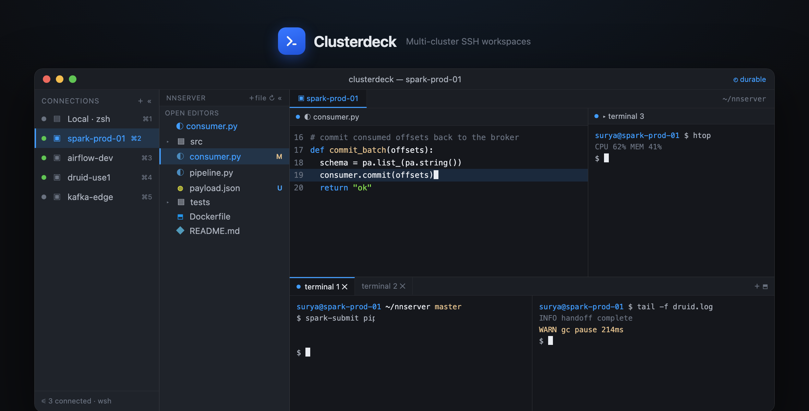

# Clusterdeck — Design Considerations

A VS Code–style terminal workspace for working across many SSH clusters in a single window. Working title: **Clusterdeck**. macOS-first.

---

## 1. Problem statement

Two existing workflows, each with a gap:

| Workflow | Gives you | Missing |
|---|---|---|
| iTerm / Terminal.app + manual SSH | Fast multi-session terminals | No inline file editing; manual `vim`/`scp` for every edit |
| VS Code Remote-SSH | Local-feel file tree + editor, save-in-place | One window **per host**; no consolidated multi-cluster view |

**Goal:** one window that combines VS Code's file explorer + editor + integrated terminals with a multi-cluster SSH session manager, so switching clusters is a click, not a new window.

---

## 2. Prior art evaluated

| Tool | Verdict |
|---|---|
| **Wave Terminal** | Closest existing fit — SSH manager, durable sessions, VS Code–like remote editor, split blocks. Model is *free-floating tiled blocks*, not a fixed IDE explorer→editor layout. Good fallback / reference implementation. |
| **Tabby** | Traditional SSH profile manager + splits + SFTP panel. Remote editing is copy-based, not true inline. |
| **TUI stack** (`zellij` + `yazi` + `helix`) | Fully user-installable (no admin, MDM-safe), runs over the SSH pipe. Less pretty; no GUI editor pane. |

**Why build:** none nails the fixed *connection = workspace* model with a persistent explorer that auto-routes file clicks into one shared editor pane. That specific behavior is the reason to build rather than adopt.

> Recommendation: prototype Clusterdeck, but validate Wave first — if its block model is acceptable, it saves the entire build.

---

## 3. Core concept — connection is the workspace

The single most important design decision:

- **A connection is not a per-terminal setting. It is the workspace.**
- Selecting a connection in the left rail sets context for the **entire window** — explorer, editor, and every terminal bind to that one session.
- Switching connections swaps the whole view to that host's own layout.
- Terminals are never individually re-pointed. `+` opens another terminal *on the active session*, no prompt.

This is the mental model the whole UI hangs off: **the rail is a workspace switcher, not a pane selector.**

---

## 4. Layout — three independent vertical zones

```
┌──────────────────────────────────────────────────────────┐
│  macOS title bar                                            │
├────────────┬────────────┬──────────────────────────────────┤
│ SHELL      │ EXPLORER   │ [ context bar: active connection ]│
│ CONNECTIONS│ (full ht)  │──────────────────┬────────────────│
│ (full ht,  │            │  Editor          │ Terminal 3     │
│  collaps-  │ file tree  │  (opens here     │ [+] [×]        │
│  ible)     │            │   on click)      │                │
│            │            │──────────────────┴────────────────│
│            │            │  Terminal 1 [×]  Terminal 2 [×] [+]│
│            │            │  (split terminals)                 │
└────────────┴────────────┴──────────────────────────────────┘
```

Rendered — the three zones bound to one SSH connection (see
[`clusterdeck-demo.html`](clusterdeck-demo.html) for the animated version):



| Zone | Spans | Purpose |
|---|---|---|
| Shell connections rail | Full height | Workspace switcher. Collapsible to icon-only strip. |
| Explorer | Full height | Remote directory tree for the active connection. |
| Main (editor + terminals) | Fills remainder | Top: editor + optional side terminal. Bottom: terminal panel. |

Deliberately **no VS Code activity bar** — only the explorer and connections rail. Keep chrome minimal.

---

## 5. Component behaviors

### 5.1 Shell connections rail
- Lists saved connections (`Local · zsh`, plus SSH hosts) with a live status dot (green = connected, gray = idle/saved) and a `⌘1`–`⌘n` hotkey.
- Active connection is highlighted and shows a secondary line: terminal count + layout state (e.g. `3 terminals · custom layout`).
- **Collapsible** via `«` — minimized shows server icons + status dots only; expands back to labels.
- `+` adds a new saved connection.
- Footer shows aggregate status (`3 connected`).

### 5.2 Explorer
- Full-height column, independent of the editor/terminal split.
- Shows the active connection's remote tree over SFTP.
- **Clicking a file opens it only in the top editor pane.** Terminals are never disturbed.
- Refresh control to re-read the remote tree.

### 5.3 Editor
- Tabbed, Monaco-based, editing remote files over SFTP.
- Save writes straight back to the remote host — no `vim`, no `scp`.

### 5.4 Terminals
- All terminals in a workspace are bound to the active connection — same host, no per-terminal picker.
- **Side terminal (Terminal 3):** `+` add, `×` remove.
- **Bottom panel (Terminal 1/2):** per-tab `×` remove, shared `+` add, split control (horizontal/vertical).
- Terminals are peers on one session; labels are generic (`Terminal N`), not per-host.

### 5.5 Context bar
- Accent strip above the main area showing active connection + cwd + layout-saved indicator.
- Reinforces that everything below belongs to one session.

---

## 6. Per-connection layout persistence

- **Each connection owns its layout.** First open uses a default; any change (splits, added/removed terminals, which file is open, pane sizes) is saved to that connection.
- Switching away and back restores the connection's last arrangement.
- Layout persists **to disk** (survives app restart; potentially syncable), not just in-memory.

Minimum persisted record per connection:

```jsonc
{
  "id": "spark-prod-01",
  "host": "spark-prod-01",        // resolved from ~/.ssh/config
  "user": "dev",
  "port": 22,
  "layout": {
    "explorerWidth": 132,
    "openFile": "consumer.py",
    "panes": [
      { "zone": "editor-side", "terminals": ["t3"] },
      { "zone": "bottom", "split": "vertical", "terminals": ["t1", "t2"] }
    ]
  },
  "terminals": [
    { "id": "t1", "cwd": "~/nnserver", "lastCmd": "spark-submit pipeline.py" },
    { "id": "t2", "cwd": "~",           "lastCmd": "tail -f druid.log" },
    { "id": "t3", "cwd": "~/nnserver", "lastCmd": "htop" }
  ]
}
```

---

## 7. Technical architecture

| Concern | Choice | Notes |
|---|---|---|
| App shell | **Tauri** (Rust) or Electron | Tauri = lighter binary, MDM-friendlier; Electron = same lineage as VS Code, richer ecosystem. |
| Terminal rendering | `xterm.js` | One instance per terminal pane. |
| Local PTY | `node-pty` (Electron) / Rust pty (Tauri) | For the `Local · zsh` connection. |
| SSH shell + SFTP | `ssh2` (Node) / `russh` (Rust) | Shell channel for terminals, SFTP for explorer + editor read/write. |
| Editor pane | `monaco-editor` | Same component as VS Code. |
| Connection source | `~/.ssh/config` (primary) + app store (extras) | See §8.1. |
| Layout store | Local JSON / SQLite in app data dir | Per-connection records from §6. |
| Secrets | macOS Keychain | Never store keys/passphrases in plaintext config. |

The mockup maps almost 1:1 to the component tree — the layout zones are the top-level components.

---

## 8. Open design decisions

### 8.1 Connection source of truth
- **Option A — reuse `~/.ssh/config`:** parse existing hosts, auto-populate the rail, stays in sync with plain `ssh`. Preferred when clusters already live there.
- **Option B — app-managed store:** own profiles with startup commands, auto-`cd`, venv activation, color, hotkey.
- **Recommended:** A as source of truth, B layered on top for the extras (auto-activate venv, auto-`cd ~/nnserver`, etc.).

### 8.2 Reconnect behavior — the hard part
When a connection drops:
- **Layout-only restore (easy):** rebuild panes, splits, cwd, open file → fresh prompts. Straightforward.
- **Live-process restore (hard):** re-attach to a running `spark-submit` / `tail -f`. Requires `tmux`/`mosh` on the remote or a persistent agent.
- **Decision needed:** is fresh-prompt-on-reconnect acceptable, or is durable session restore a hard requirement? (Wave solves this with durable sessions — reference if needed.)

### 8.3 MDM / no-admin constraints (macOS)
- Corporate-managed Mac without admin: Electron/Tauri app must run from `~/Applications` (no `/Applications` write).
- Risk: MDM app-allowlisting may block an unsigned/unapproved binary regardless. Test launch early.
- Fallback if blocked: the TUI stack (`zellij` + `yazi` + `helix`) is fully user-installable.

---

## 9. Build phases

| Phase | Deliverable | Proves |
|---|---|---|
| 0 | App shell + macOS window chrome | Tauri/Electron runs from `~/Applications` |
| 1 | **Connection→workspace core** | Parse `~/.ssh/config` → rail; click host → open a real `xterm.js` + `ssh2` terminal bound to the session |
| 2 | Explorer over SFTP + Monaco editor | Click file → opens in top editor; save writes back |
| 3 | Multi-terminal: add/remove/split, all bound to active session | §5.4 behaviors |
| 4 | Per-connection layout persistence | §6 — switch connection restores its layout |
| 5 | Collapsible rail, context bar, polish | Matches approved mockup |
| 6 | (Optional) Durable sessions on reconnect | §8.2 hard path |

Phase 1 is the spine — everything else hangs off the connection→workspace binding.

---

## 10. Hard parts / risk register

| Risk | Impact | Mitigation |
|---|---|---|
| SFTP ↔ editor sync (dirty state, external edits, large files) | Data loss / stale buffers | Version/mtime checks; conflict prompt on save. |
| Durable session restore | High engineering cost | Defer to Phase 6; lean on remote `tmux` if needed. |
| MDM blocks the binary | Whole GUI approach dead | Validate in Phase 0; TUI fallback ready. |
| `~/.ssh/config` edge cases (`ProxyJump`, `Match`, includes) | Missing/incorrect hosts | Use a battle-tested config parser, not hand-rolled. |
| Per-connection layout schema churn | Migration pain | Version the layout record from day one. |

---

## Appendix — glossary

- **Connection / workspace** — a saved shell target (`Local`, or an SSH host). Owns its own layout and terminals.
- **Session** — the live connection instance a workspace's terminals share.
- **Layout** — persisted arrangement of explorer, editor, and terminal panes for one connection.
